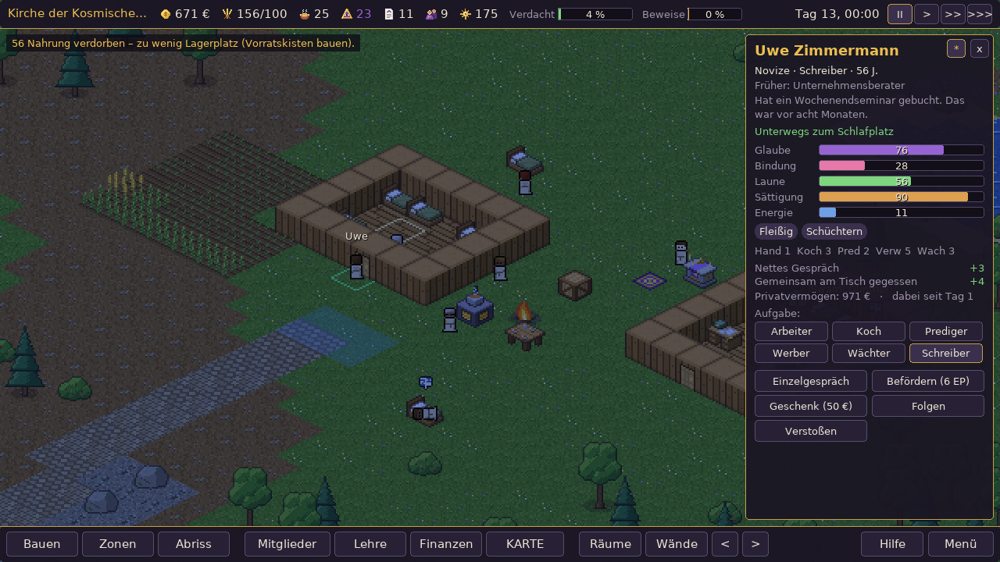
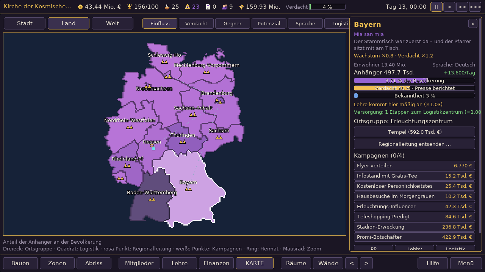

# Cult-Sim – Prototyp

Satirische Siedlungssimulation: Du baust als Guru eine Sekte auf – vom zugigen Schuppen am Waldrand
bis zur (hoffentlich) anerkannten Weltreligion. Aufbau und Einzelsimulation im Stil von Kolonie-Sims,
Expansion über einen Kartenmodus im Stil großer Strategiespiele.




## Starten

Voraussetzung: [uv](https://docs.astral.sh/uv/) (lädt Python und pygame-ce selbst nach).

| | |
|---|---|
| Linux | `./run.sh` oder `uv run main.py` |
| Windows | `run.bat` oder `uv run main.py` |
| ohne uv | `pip install pygame-ce` und `python main.py` (Python ≥ 3.11) |

Optionen: `--fullscreen`, `--size=1600x900`, `--no-audio`, `--load` (Schnellspeicherstand laden).

## Steuerung

| Taste | Funktion |
|---|---|
| WASD / Pfeile, mittlere Maustaste ziehen | Kamera |
| Mausrad, + / − | Zoom (ganzzahlig, pixelgenau) |
| Q / E | Ansicht in 90°-Schritten drehen |
| Leertaste, 1 / 2 / 3 | Pause, Tempo |
| B / Z / X | Bauen / Zonen / Abriss (Rechtsklick legt das Werkzeug ab) |
| Shift beim Ziehen | Wand/Zaun als Rechteck-Umriss |
| F1 / F2 / F3 | Mitglieder / Lehre & Regeln / Finanzen |
| M oder Tab | Kartenmodus (Stadt, Land, Welt) |
| R / H | Räume einfärben / Wände niedrig |
| F5 / F9 | Schnellspeichern / -laden |
| F10, F11, N, Esc | Hilfe, Vollbild, Musik, Menü |

Guru auswählen + Rechtsklick schickt ihn an einen Ort. Mitglieder anklicken: Aufgabe, Beförderung,
Einzelgespräch, Geschenk, Favorit, Verstoßen.

## Was der Prototyp kann

**Gelände (isometrisch, drehbar)**
- Freies Bauen ohne feste Bauplätze: Wände, Türen, Zäune, Tore, Böden, Möbel, Kultobjekte.
- Räume und Gehege entstehen per Flächenberechnung: von Wänden umschlossen = Raum, von Zäunen umschlossen = Hof/Gehege.
  Die Funktion (Schlafsaal, Küche, Tempel, Druckerei, Ziegengehege …) ergibt sich aus der Einrichtung, dazu ein Pracht-Wert.
- Zonen frei malbar: Anbaufeld, Besucherzone, Sperrzone.
- Versorgung: Felder → Rohkost → Kochstelle → Mahlzeiten, Lagerkapazität, Einkauf, heilige Ziegen.

**Mitglieder (einzeln simuliert)**
- Bedürfnisse, Glaube, Laune (aus konkreten Gedanken), Fähigkeiten, Eigenschaften, Vorgeschichte, Vermögen, Chronik.
- Aufgaben: Arbeiter, Koch, Prediger, Werber, Wächter (Nachtschicht), Schreiber. Tagesablauf mit Predigt, Arbeit, Freizeit, Schlaf.
- Bindung an den Guru: Einzelgespräche, Geschenke, Ränge. Hohe Bindung macht Mitglieder zu verlässlichen Regionalleitern
  und möglichen Nachfolgern, falls der Guru verhaftet wird.

**Lehre (dynamisch)**
- Drei Achsen (Geschäftssinn, Abschottung, Endzeitstimmung) wandern je nach Regeln, Gebäuden und Entscheidungen.
  Daraus ergibt sich die Ausrichtung („Wellness-Franchise“, „Endzeit-Bunkergemeinde“ …) mit eigenen Boni.
- 20 Regeln von „Der Zehnt“ über „Liebesbombardement“ bis „Weltuntergangs-Countdown“.

**Gegner**
- Extern: Journalisten (sammeln auf dem Gelände Material), Behördenkontrollen, besorgte Angehörige, Razzien
  (Polizei, später Militär); auf der Karte Presse → Auflagen → Verbotsverfahren → Verbot.
- Intern: Zweifler, nächtliche Fluchtversuche, Abweichler mit Kirchenspaltung, Maulwürfe, abtrünnige Regionalleiter.
- Verteidigung: Zäune und Tore, Wächter und Wachtürme, Ausgangssperre, PR, Lobby, Anwälte, Akten schreddern.

**Kartenmodus in drei Phasen**
- Stadt (fiktives Bad Sülzheim) → Land (16 Bundesländer) → Welt (28 Regionen).
- Kampagnen, Ortsgruppen in drei Ausbaustufen, entsandte Mitglieder als Regionalleitung.
- Regionale Eigenheiten, kulturelle Vorlieben (passt die Lehre zur Region?), Sprachen mit Übersetzungen, Logistikzentren.
- Kartenmodi: Einfluss, Verdacht, Gegner, Potenzial, Sprache, Logistik.
- Phase 3: Großprojekte bis zur Anerkennung als Weltreligion (Siegbedingung).

## Projektaufbau

Ausführliche Entwicklerdokumentation mit Einarbeitung in neun Schritten: [docs/entwicklung/](docs/entwicklung/README.md).

```
main.py              Einstieg
cultsim/sim/         Simulation ohne pygame (headless lauffähig)
  world.py           Gitter, Bauen, Räume/Gehege, Regeln, Tagesabrechnung, Speichern
  pawns.py           Figuren-KI: Mitglieder, Besucher, Presse, Behörden, Polizei, Ziegen
  strategic.py       Kartenebene: Regionen, Kampagnen, Gegner, Logistik
  events.py          Ereignis-Engine und Systemereignisse (Razzia, Spaltung, Maulwurf …)
  path.py            A*-Wegfindung
cultsim/ui/          Darstellung: render.py (Iso), hud.py (Panels), mapview.py (Karte), app.py (Hauptschleife)
cultsim/assets.py    Lädt Sprites/Sounds über das Manifest
data/                Alle Inhalte als JSON (Gebäude, Eigenschaften, Regeln, Ereignisse, Kampagnen, Karten, Namen)
assets/              Grafik, Ton, manifest.json
tools/               Generator für Platzhalter-Assets, Kartenvorschau, Tests
```

## Assets ersetzen und erweitern (für Artists)

Alles läuft über `assets/manifest.json`. Eine Datei austauschen heißt: PNG/WAV mit gleichem Namen überschreiben.
Andere Maße sind erlaubt, solange `anchor` im Manifest stimmt.

```json
"sprites": { "altar": {"file": "sprites/altar.png", "anchor": [16, 24], "frames": 1} },
"sounds":  { "click": {"file": "sfx/click.wav", "volume": 0.6} },
"music":   [ {"file": "music/drone_organ.wav", "title": "Orgel der Erleuchtung"} ]
```

- **Kachel**: 32×16 px Raute. `anchor` ist der Pixel im Frame, der auf der Kachelmitte liegt.
  Blöcke (Wände) sind die Raute, um die Höhe nach oben gezogen: 32×(16+h), Anker `[16, 8+h]`.
- **frames**: horizontaler Streifen gleich breiter Frames (Varianten bei Terrain/Bäumen, Animation bei Feuer, Laufzyklus bei Figuren).
- **Drehung**: Sprites werden nicht gedreht; Objekte sollten von allen Seiten plausibel aussehen.
  Zäune setzen sich aus `fence_post` und vier Latten `fence_rail_ne/nw/se/sw` zusammen.
- **Figuren**: Graustufen-Ebenen, die das Spiel einfärbt: `pawn_skin_*`, `pawn_robe_*` (Mitglieder), `pawn_civ_*` (Außenstehende),
  `pawn_hair_*`, jeweils `_front`/`_back` mit 3 Frames (Stand, Schritt A, Schritt B), 12×18 px. Dazu farbige Aufsätze `acc_*`.
- **Wände niedrig**: optionale Varianten mit Endung `_low`.
- **Schrift**: `assets/fonts/ui.ttf` (und optional `ui-bold.ttf`) ablegen, sonst wird eine Systemschrift genommen.
- **Musik/Ton**: WAV oder OGG, Pfad im Manifest eintragen.
- `tools/gen_assets.py` erzeugt die Platzhalter neu – nicht ausführen, wenn eigene Dateien in `assets/` liegen (sie würden überschrieben).

**Mods ohne Überschreiben**: Ordner `mods/<name>/assets/manifest.json` (gleiche Struktur, eigene Dateien) und
`mods/<name>/data/*.json` werden über die Basisdaten gelegt. Beispiel für ein neues Möbel:

```json
// mods/meinmod/data/buildables.json
{ "thron": {"name": "Thron", "cat": "Kult", "kind": "object", "sprite": "thron", "blocks": true,
            "cost": 500, "work": 150, "drag": "single", "pracht": 8, "doctrine": {"commerce": 4}} }
```

Fehlt ein Sprite, zeichnet das Spiel einen farbigen Platzhalter, statt abzustürzen.

**Inhalte erweitern**: neue Ereignisse in `data/events.json` (Bedingungen, Auswahl, Effekte wie `money`, `heat`, `faith_all`,
`doctrine`, `spawn`, `recruit`, `random`), Regeln in `edicts.json`, Eigenschaften in `traits.json`, Kampagnen in `campaigns.json`.
Karten liegen in `data/maps/*.json` (Polygone + Regionswerte); `tools/preview_maps.py <ordner>` prüft und rendert sie.

## Tests und Werkzeuge

```
uv run python tools/smoke_test.py 60        # Auto-Spieler, 60 Tage headless, Kennzahlen
uv run python tools/unit_test.py            # Räume, Gehege, Razzia, Kartenebene
uv run python tools/monkey_test.py 5000     # Zufallsklicks durch die echte Oberfläche
uv run python tools/screenshot.py <ordner>  # UI-Screenshots ohne Fenster
```

## Stand und Grenzen

- Getestet unter Linux (SDL-Treiber x11, Python 3.14, pygame-ce 2.5.8). Der Code nutzt nur plattformneutrale Mittel,
  **unter Windows wurde er aber noch nicht gestartet**.
- Eine eigenständige `.exe` sollte per `uv run --with pyinstaller pyinstaller --windowed --name CultSim main.py` entstehen;
  `assets/` und `data/` gehören dann neben die Datei. Das ist vorbereitet (Pfadlogik), aber ungetestet.
- Balance ist grob: Ein simpler Auto-Spieler erreicht Phase 2 um Tag 30 und Phase 3 um Tag 115.
- Vereinfachungen: Ressourcen sind Zähler (kein Tragen einzelner Güter), alle Objekte belegen eine Kachel, keine Dächer/Höhenstufen,
  Spielstände sind Python-Pickles (nicht versionsfest, nur eigene Spielstände laden), Texte sind nur deutsch und nicht ausgelagert.
- Grafik und Ton sind generierte Platzhalter.
